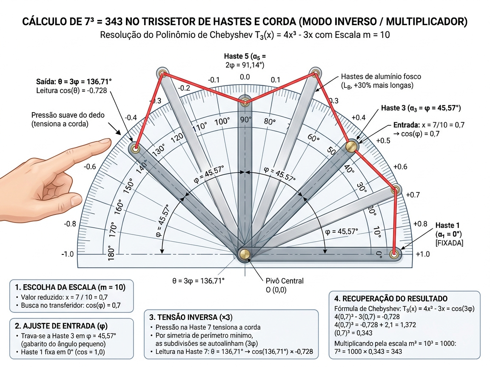

# A Resolução da Trissecção e N-Secção do Ângulo via Mecanismos Cinemáticos Variacionais

**Autor:** Luiz Augusto Prado — `1807787` (UnB)  
**Área:** Geometria Mecânica, Cinemática Geométrica e Otimização  
**Licença:** Domínio Público ([CC0 1.0](https://creativecommons.org))
**Mais detalhe:** sirmartmiracle (https://sirmathmiracle.blogspot.com/2026/11/triseccao-de-angulos-abordagem-inedita.html)

---

## Resumo

Este trabalho apresenta uma abordagem inédita para o problema clássico da trissecção do ângulo, superando as limitações da geometria euclidiana estrita por meio de um sistema cinemático articulado de hastes e corda. Demonstra-se formalmente que, ao modelar a partição angular sob o princípio variacional do menor perímetro de uma corda tensionada, a configuração de equilíbrio estável do dispositivo divide qualquer ângulo plano em três partes iguais. O modelo é posteriormente generalizado para a divisão em $N$ partes iguais e aplicado à resolução analógica de polinômios de Chebyshev e raízes cúbicas. O projeto é disponibilizado sob licença de domínio público (CC0 1.0).

## Abstract

This paper presents an unprecedented approach to the classical problem of angle trisection, overcoming the limitations of strict Euclidean geometry through an articulated kinematic system of rods and string. It is formally demonstrated that, by modeling angular partition under the variational principle of the minimum perimeter of a tensioned string, the stable equilibrium configuration of the device divides any plane angle into three equal parts. The model is further generalized to $N$-section and applied to the analog resolution of Chebyshev polynomials and cube roots. The project is released under a public domain license (CC0 1.0).

---

## 1. Fundamentação Axiomática (Contexto Teórico)

Desde os primórdios da geometria entre os sumérios e os gregos, o estudo das formas e proporções consolidou-se sobre restrições estáticas. A impossibilidade clássica da trissecção de um ângulo arbitrário é uma imposição da geometria euclidiana ao uso de régua e compasso.

Entretanto, para expandir a geometria para além do papel estático, torna-se necessário estabelecer um princípio construtivo dinâmico: para operar geometricamente no espaço, precisamos decidir quais elementos serão fixados e quais poderão correr livremente. Nesse paradigma, a estrutura divide-se entre elementos rígidos e elementos flexíveis — sendo estes últimos estritamente inextensíveis e não elásticos, para que conservem o rigor métrico sem deformação.

Ao manter a rigidez estrutural das arestas (hastes) e distribuir sobre elas ilhoses ou furos-guia nas posições desejadas, em conjunto com uma corda inextensível e pontas de fixação, cria-se um sistema híbrido. A estrutura rígida garante o suporte e a referência espacial, enquanto o elemento flexível corre livremente pelos ilhoses, permitindo atingir pontos, curvas ou retas no espaço de forma simples ou complexa. Esse arranjo não apenas transfere o problema das construções estáticas para o cálculo variacional, mas estabelece a base cinemática primária a partir da qual mecanismos ainda mais elaborados — como sistemas de engrenagens — podem ser concebidos e construído.

---

## 2. Arquitetura Física e Cinemática (Especificação do Dispositivo)

O mecanismo base consiste em uma cadeia cinemática plana composta por **7 hastes rígidas** conectadas a um eixo pivô comum na origem $O = (0,0)$ de um sistema de coordenadas cartesianas. As posições angulares de cada haste em relação ao semieixo positivo $X$ são denotadas por $\alpha_i$ (para $i = 1, 2, \dots, 7$).

A estrutura física obedece às seguintes especificações de montagem e proporção:

* **Hastes Ímpares ($i = 1, 3, 5, 7$ — Referência e Trissecção):** Quatro lâminas de comprimento fixo $L_A$ (por exemplo, $20\text{ cm}$), fabricadas em acrílico escuro transparente com fenda longitudinal centralizada para marcação gráfica. As hastes $\alpha_1 = 0$ e $\alpha_7 = \theta$ atuam como fronteiras rígidas que delimitam o ângulo total $\theta$ a ser dividido.
* **Hastes Pares ($i = 2, 4, 6$ — Alavancas Intermediárias):** Três lâminas móveis de comprimento fixo $L_B$ (por exemplo, $30\text{ cm}$), fabricadas em alumínio ou material rígido fosco, intercaladas entre as hastes ímpares.
* **Sistema de Tensão:** Uma corda inextensível e flexível, fixada na extremidade da haste $\alpha_1$, passa sequencialmente por orifícios (olhais) localizados nas extremidades externas de todas as hastes até ser tracionada na extremidade da haste $\alpha_7$.
* **Base de Leitura:** Um transferidor semicircular de $180^\circ$ acoplado concentricamente sob o eixo pivô $O$, alinhado ao eixo de referência $X$.

---

## 3. Demonstração Analítica e Variacional (Teorema da Trissecção)

> [!IMPORTANT]
> **Teorema 1 (Teorema da Trissecção Mecânica Variacional):** Seja um feixe planar de $7$ hastes articuladas na origem $O$, com comprimentos estritamente alternados $|H_i| = L_A$ para $i \in \{1, 3, 5, 7\}$ e $|H_i| = L_B$ para $i \in \{2, 4, 6\}$, delimitadas por $\alpha_1 = 0$ e $\alpha_7 = \theta$ (com $0 < \theta < \pi$). Sob tração contínua de uma corda inextensível que conecta sequencialmente as extremidades das hastes, o estado de equilíbrio mecânico de perímetro mínimo posiciona necessariamente as hastes internas $H_3$ e $H_5$ nos ângulos absolutos $\alpha_3 = \frac{\theta}{3}$ e $\alpha_5 = \frac{2\theta}{3}$.

### Demonstração

O comprimento $d_i$ de cada um dos $6$ segmentos de corda entre duas hastes adjacentes $i$ e $i+1$ é dado pela Lei dos Cossenos:

$$d_i = \sqrt{|H_i|^2 + |H_{i+1}|^2 - 2|H_i||H_{i+1}|\cos(\alpha_{i+1} - \alpha_i)}$$

Devido à alternância estrita entre $L_A$ e $L_B$, a soma dos quadrados e o produto dos comprimentos adjacentes são constantes para todo $i \in \{1, \dots, 6\}$:

$$C = L_A^2 + L_B^2 \quad \text{e} \quad k_1 = L_A \cdot L_B$$

Definindo a abertura angular local como $\Delta\alpha_i = \alpha_{i+1} - \alpha_i$, a função do perímetro total da corda $S$ é expressa por:

$$S(\Delta\alpha_1, \dots, \Delta\alpha_6) = \sum_{i=1}^{6} \sqrt{C - 2k_1\cos(\Delta\alpha_i)}$$

O estado de equilíbrio físico corresponde ao mínimo global de $S$ sujeito à restrição geométrica de contorno $\sum_{i=1}^{6} \Delta\alpha_i = \theta$. Aplicando o método dos Multiplicadores de Lagrange, define-se o Lagrangiano $\mathcal{L}$:

$$\mathcal{L}(\Delta\alpha_1, \dots, \Delta\alpha_6, \lambda) = \sum_{i=1}^{6} \sqrt{C - 2k_1\cos(\Delta\alpha_i)} - \lambda \left( \sum_{i=1}^{6} \Delta\alpha_i - \theta \right)$$

Embora as hastes possam girar livremente sobre o mesmo pivô e eventualmente se sobrepor ($\Delta\alpha_i \le 0$), observa-se que o comprimento de cada segmento $d(\Delta\alpha_i) = \sqrt{C - 2k_1\cos(\Delta\alpha_i)}$ é uma função par e estritamente crescente em relação ao módulo $|\Delta\alpha_i|$ no intervalo $[0, \pi]$. Se algum subângulo assumisse valor nulo ou negativo ($\Delta\alpha_j \le 0$), a restrição de contorno $\sum \Delta\alpha_i = \theta > 0$ exigiria que outros segmentos aumentassem sua abertura para compensar, elevando estritamente o perímetro total $S$. Portanto, o mínimo global ocorre necessariamente com as hastes ordenadas e sem cruzamentos, no interior do domínio $\Delta\alpha_i \in (0, \pi)$.

Igualando as derivadas parciais de primeira ordem a zero $\left(\frac{\partial \mathcal{L}}{\partial \Delta\alpha_i} = 0\right)$, obtém-se para cada segmento $i$:

$$\lambda = \frac{k_1 \sin(\Delta\alpha_i)}{\sqrt{C - 2k_1\cos(\Delta\alpha_i)}}$$

A função $f(x) = \frac{k_1 \sin(x)}{\sqrt{C - 2k_1\cos(x)}}$ é estritamente monótona e injetiva no intervalo operacional $(0, \pi)$. Portanto, a igualdade $f(\Delta\alpha_i) = \lambda$ para todo $i$ implica a igualdade de todos os subângulos internos:

$$\Delta\alpha_1 = \Delta\alpha_2 = \Delta\alpha_3 = \Delta\alpha_4 = \Delta\alpha_5 = \Delta\alpha_6 = \Delta\alpha$$

Substituindo na equação de restrição, tem-se $6\Delta\alpha = \theta \implies \Delta\alpha = \frac{\theta}{6}$.

Calculando as posições angulares acumuladas:

* $\alpha_1 = 0$
* $\alpha_2 = \frac{\theta}{6}$
* $\alpha_3 = 2\left(\frac{\theta}{6}\right) = \frac{\theta}{3}$ *(Primeira Trissetriz)*
* $\alpha_4 = 3\left(\frac{\theta}{6}\right) = \frac{\theta}{2}$
* $\alpha_5 = 4\left(\frac{\theta}{6}\right) = \frac{2\theta}{3}$ *(Segunda Trissetriz)*
* $\alpha_6 = 5\left(\frac{\theta}{6}\right) = \frac{5\theta}{6}$
* $\alpha_7 = 6\left(\frac{\theta}{6}\right) = \theta$

> [!NOTE]
> **Corolário 1 (Estabilidade e Autocompensação):** A matriz Hessiana associada à segunda variação do perímetro ($\delta^2 S$) é estritamente definida positiva em todo o domínio operacional $(0, \pi)$. Consequentemente, o ponto de equilíbrio é único e estável: qualquer perturbação externa gera uma componente vetorial de tensão restauradora que retorna o sistema à configuração de trissecção exata. Assim, o perímetro da corda no interior do aparelho é mínimo se, e somente se, o ângulo tiver sido trisseccionado de forma igual.

---

## 4. Generalização Algébrica (Teorema da N-Secção Universal)

> [!IMPORTANT]
> **Teorema 2 (Generalização para N-Secção Angular):** Para dividir um ângulo plano $\theta$ em $N$ partes iguais ($N \in \mathbb{N}, N \ge 2$), o mecanismo requer um total de $H = 2N + 1$ hastes articuladas na origem $O$, compostas por $N + 1$ hastes de referência de comprimento $L_A$ (índices ímpares) e $N$ hastes intermediárias de comprimento $L_B$ (índices pares).

### Demonstração

Com $H = 2N + 1$ hastes intercaladas, formam-se $2N$ segmentos de corda idênticos em parâmetros geométricos ($C$ e $k_1$). Pela mesma condição variacional do Teorema 1, os $2N$ subângulos locais igualam-se a $\Delta\alpha = \frac{\theta}{2N}$. As hastes ímpares internas de ordem $2m + 1$ (para $m = 1, 2, \dots$)

